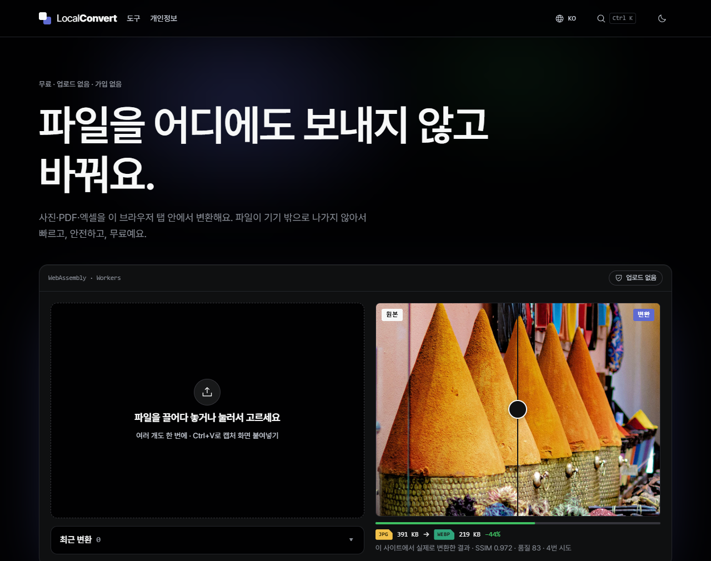
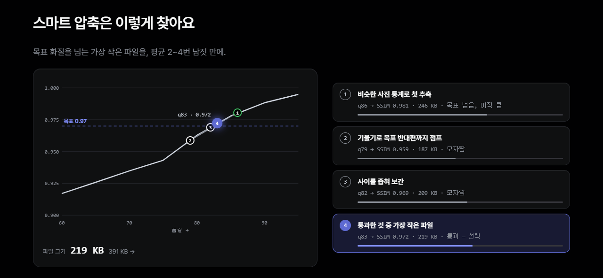
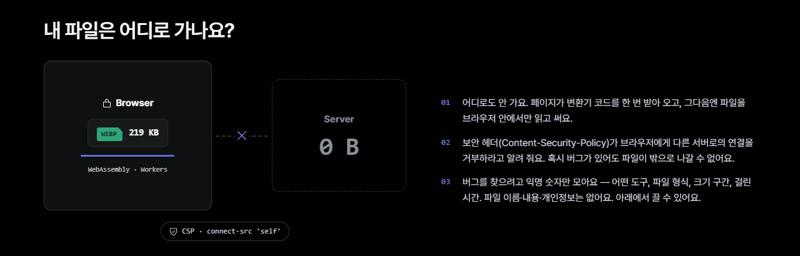
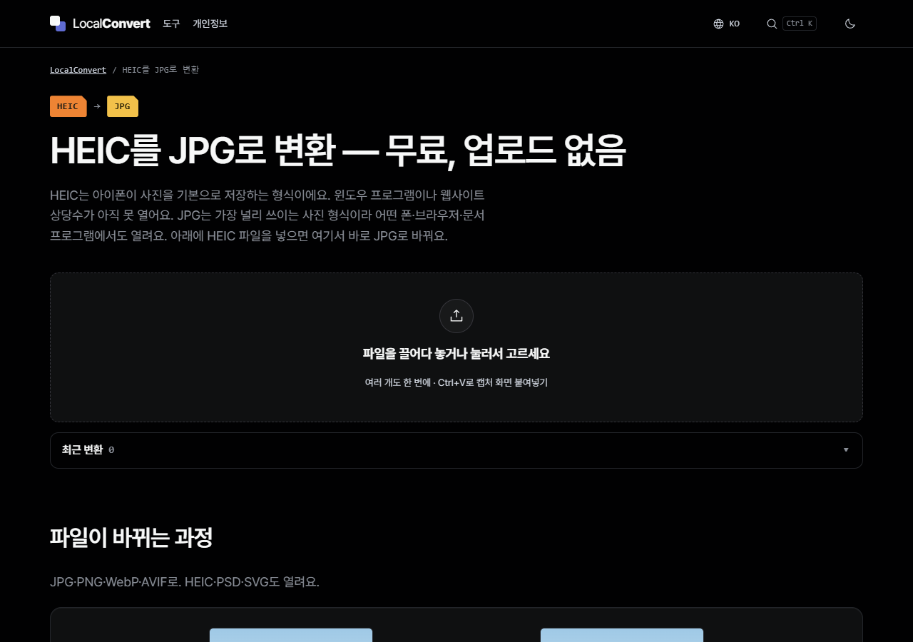
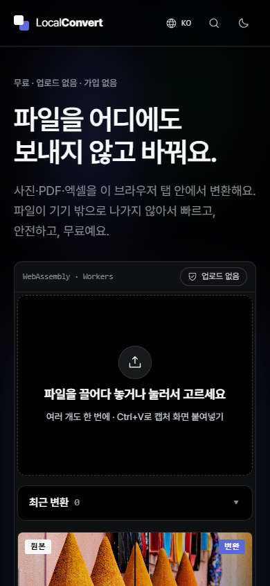
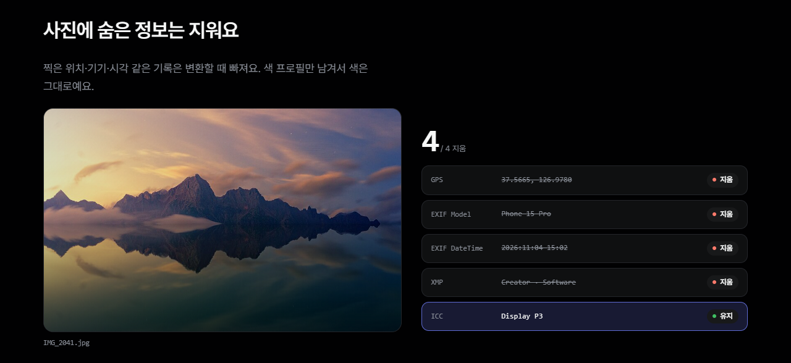
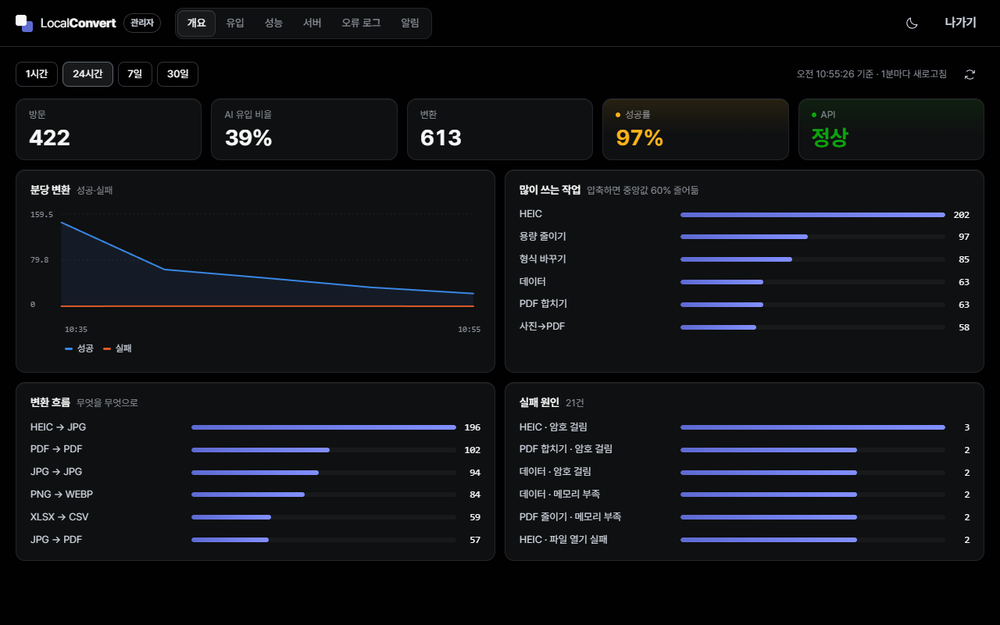
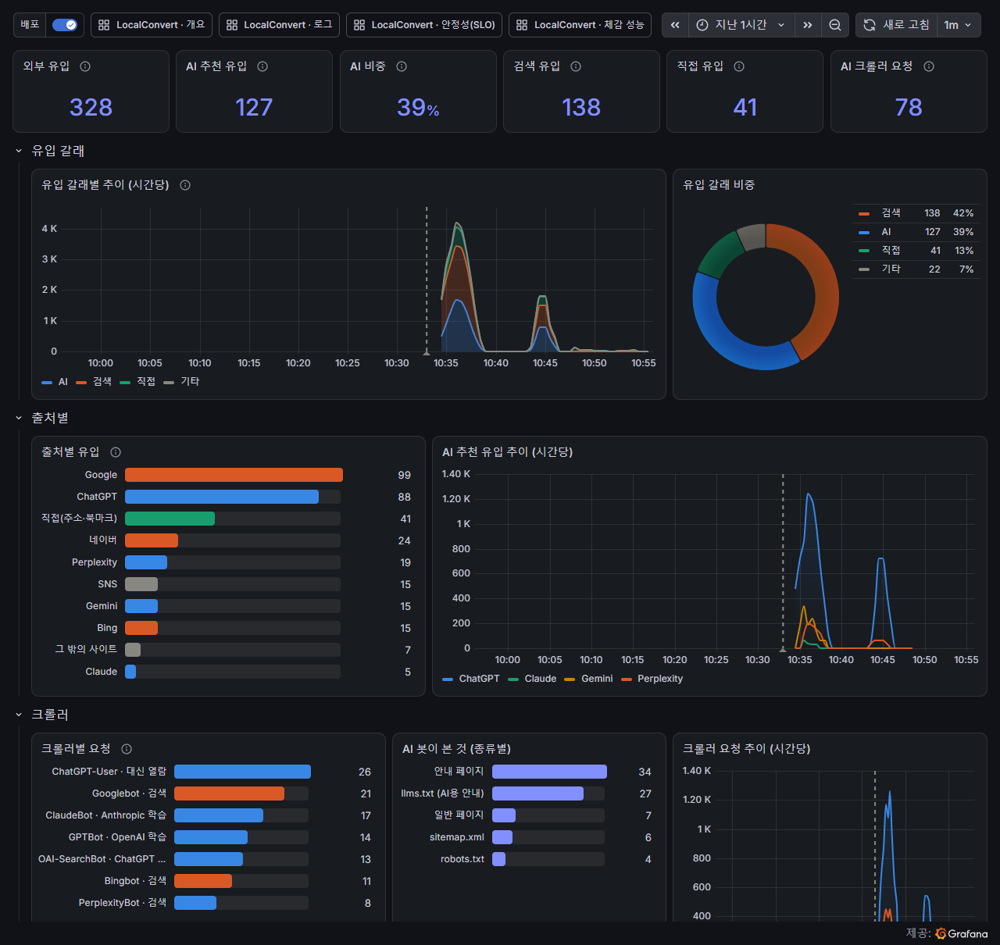
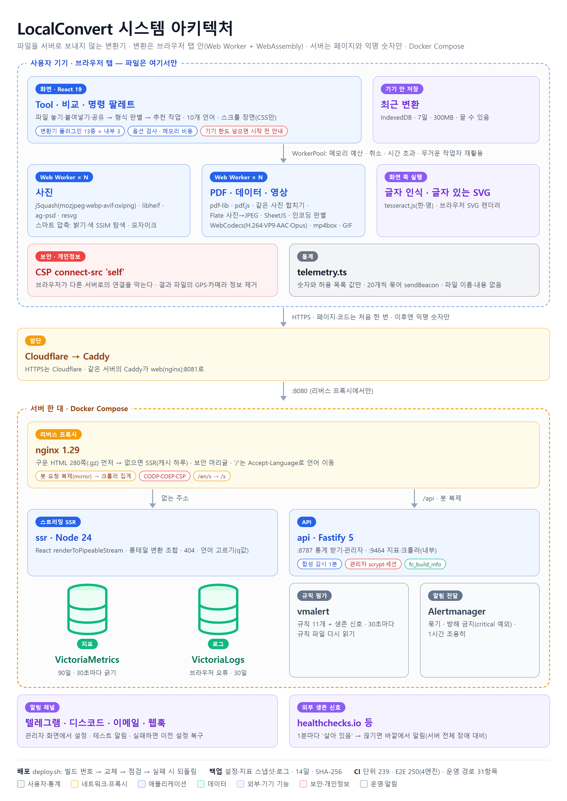

# LocalConvert — 파일을 서버로 보내지 않는 브라우저 변환기


**라이브: <https://convert.getqrmaker.com>** (Oracle Cloud VM, HTTPS는 Cloudflare, 2026-11 공개)

사진·PDF·엑셀·영상을 **서버로 보내지 않고 브라우저 탭 안(Web Worker + WebAssembly)에서** 변환하는 공개 웹서비스입니다. 광고·회원가입이 없습니다.
서버는 페이지를 내주고 익명 숫자(형식·크기·처리 시간)만 받으며, CSP `connect-src 'self'`로 파일 바이트가 다른 서버로 나갈 경로 자체를 막았습니다. 운영자는 이 숫자로 대시보드와 알림(VictoriaMetrics·vmalert·Alertmanager)을 봅니다.
영어가 기본(`/`)이고 한국어·스페인어·포르투갈어·독일어·프랑스어·일본어·힌디어·인도네시아어·중국어(간체)는 `/ko` `/es` … 아래에 **10개 언어**로 제공합니다. 렌더링은 **하이브리드 렌더링**입니다. 주요 280페이지는 빌드 시점에 React 19 `prerenderToNodeStream`으로 완성된 HTML을 만들어 두는 **정적 사이트 생성(SSG)**, 목록에 없는 변환 조합은 요청이 올 때 Node 서버가 `renderToPipeableStream`으로 그려 보내는 **스트리밍 SSR** + nginx 캐시로 내줍니다. 검색엔진·AI 크롤러는 자바스크립트를 실행하지 않고도 완성된 본문을 읽고, 사용자는 첫 화면을 바로 받습니다.

## 스크린샷

> 로컬에서 띄운 화면을 Edge로 찍은 그림입니다(움직임 줄이기 상태 = 스크롤 장면이 끝난 정지 그림).

**메인** — 파일 놓기, 원본/변환 비교 슬라이더(이 사이트에서 실제로 변환한 결과)



<table>
  <tr>
    <td width="50%"><br><sub><b>스마트 압축</b> — 목표 SSIM을 넘는 가장 작은 파일을 평균 2&#126;4번 시도로 찾는 과정(실제 기록)</sub></td>
    <td width="50%"><br><sub><b>파일은 어디로 가나</b> — 변환은 브라우저 안, 서버로 가는 파일 바이트 0</sub></td>
  </tr>
  <tr>
    <td width="50%"><br><sub><b>변환별 안내 페이지</b> — 정적 사이트 생성(SSG), 10개 언어 (<code>/ko/heic-to-jpg</code>)</sub></td>
    <td width="50%" align="center"><br><sub><b>모바일(어두운 화면)</b> — 390px</sub></td>
  </tr>
  <tr>
    <td colspan="2"><br><sub><b>숨은 정보 지우기</b> — 위치·기종·촬영 시각(EXIF·XMP)은 변환 때 빠지고 색 프로필(ICC)만 남음(값은 보기용 예시)</sub></td>
  </tr>
  <tr>
    <td width="50%"><br><sub><b>관리자 화면</b> — 변환·유입·성능·서버·오류 로그·알림(로컬 스택의 시험용 가상 자료)</sub></td>
    <td width="50%"><br><sub><b>Grafana</b> — 같은 지표를 길게 보는 대시보드 5개, 코드로 관리(시험용 가상 자료)</sub></td>
  </tr>
</table>

## 주요 기능

- **이미지**: HEIC·AVIF·WebP·PNG·JPG·PSD·SVG 상호 변환, 크기 줄이기, **스마트 압축**(목표 화질 SSIM을 넘는 가장 작은 파일을 탐색, 밝기뿐 아니라 색 번짐까지 판정해 필요하면 4:4:4로 다시 탐색)
- **PDF**: 합치기·나누기·이미지로·이미지에서, **용량 줄이기**(같은 사진을 내용 해시로 하나로 합치기, 사진으로 판별된 Flate 이미지만 JPEG로 — SSIM 0.97·크기 관문 통과 시에만)
- **데이터**: 엑셀 ↔ CSV ↔ JSON ↔ YAML, CSV 인코딩 자동 판별
- **영상·음성**: WebCodecs 기반 변환(ffmpeg·GPL 미사용)
- **글자 인식(OCR)** 한국어·영어, **변환 기록**(기기 안 IndexedDB, 서버 저장 없음), 명령 팔레트(Ctrl+K), 여러 장 동시 처리 → ZIP
- **큰 파일**: 파일 머리(256KB)만 읽어 예상 메모리를 계산하고 기기 메모리 예산 안에서만 동시 실행, 넘으면 시작 전 '약 X 필요, 한도 Y' 안내. 결과 파일에 위치 정보(GPS)·카메라 정보를 남기지 않음
- **다국어·검색 노출**: 10개 언어 경로, `/` 첫 방문은 Accept-Language q값으로 언어 이동(봇·언어를 직접 고른 사람 제외), hreflang·사이트맵 470주소·`llms.txt`·JSON-LD·IndexNow, AI 크롤러·AI 유입 집계
- **관리자**(`/admin`): 개요·유입·성능·서버·오류 로그·알림 탭, 같은 오류 묶어 보기, 알림 기준값·채널·1시간 조용히·테스트 발송(저장하면 vmalert·Alertmanager 설정을 다시 쓰고, 적용 실패 시 이전 설정으로 복구)

## 아키텍처 (오라클 클라우드 배포 구성)



- **변환은 기기, 서버는 페이지와 숫자**: 무거운 WASM(AVIF 3.5MB·HEIC 2MB·pdf.js 1.3MB)은 해당 기능을 쓸 때만 받고, 첫 화면 JS는 gzip 90KB 예산(현재 83.3KB)을 CI에서 강제
- **변환기 플러그인 계약**: 작업 하나 = 명세 하나(`inputs`·`outputs`·`validate`·`cost`·`timeoutMs`·`load`). 화면과 워커가 같은 검사를 두 번 부르고, 계약 테스트가 화면의 모든 선택지 조합을 검사([`docs/architecture.md`](docs/architecture.md))
- **워커 풀 = 객체 풀 + 격벽 + 입장 제어**: 한 작업이 죽어도 그 워커만 버리고 새로, 큰 작업은 혼자 실행
- **관계형 DB 없음**: 통계 이벤트 → Prometheus 지표(VictoriaMetrics 90일), 브라우저 오류 → VictoriaLogs(30일). 파일 이름·내용은 통계 스키마에 자리가 없고, 라벨은 허용 목록 값만
- **단일 VM + compose**: nginx(정적·SSR 캐시·언어 이동)·SSR·API·VictoriaMetrics·VictoriaLogs·vmalert·Alertmanager, 서비스별 메모리 상한. HTTPS는 Cloudflare가 끝내고 같은 서버의 Caddy가 `web`(nginx) 하나로만 넘김([`docs/diagrams/06-deploy.png`](docs/diagrams/06-deploy.png))

| 그림 | 내용 |
|---|---|
| [변환 흐름](docs/diagrams/03-convert-flow.png) | 파일 놓기 → 옵션 검사 → 비용·한도 → 풀 입장 → 워커 → 결과 → 통계 |
| [요청 경로](docs/diagrams/04-request-routing.png) | nginx: 봇 복제 · 정적 자산 · SSG 페이지 · SSR 캐시 · 언어 이동 · 장애 시 |
| [알림 흐름](docs/diagrams/05-alert-flow.png) | 감지(vmalert) → 전달(Alertmanager) → 채널, 오류 예산 소진 속도(SLO) 규칙 |
| [스마트 압축](docs/diagrams/07-smart-compress.png) | 보통 크기 탐색(v5·병렬 v6)과 큰 사진 모자이크 탐색, 원본 유지 조건 |

## 구조

| 폴더 | 내용 |
|---|---|
| apps/web | Vite + React. 변환(워커 풀 + WASM), 플러그인 등록부, PWA, 관리자 화면(/admin), SSG·SSR 스크립트 |
| apps/api | Fastify. 통계 수신, 관리자 로그인, 지표·로그 조회 중계, 알림 설정 → Alertmanager·vmalert |
| packages/shared | 통계 스키마·지표 이름(웹·API 공용) |
| infra | docker compose: nginx(웹), ssr, api, VictoriaMetrics, VictoriaLogs, vmalert, Alertmanager, Grafana(선택, SSH 터널로만), 배포·백업·복구 스크립트 |
| bench, tools | SSIM·탐색 벤치마크, 시험 파일 생성, 아키텍처 그림, 번들 예산 |

## 로컬 실행

```
npm install
npm run dev            # 화면 개발 서버
npm run check          # 타입 검사 + 단위 테스트 + 빌드 + 번들 예산
npx playwright test    # 브라우저 테스트(Edge·WebKit·Firefox·아이폰 화면)

# 전체 스택(비밀값 .env는 프로젝트 밖에 둔다, infra/.env.example 참고)
docker compose -f infra/docker-compose.yml --env-file <경로>/fc.env up -d --build
ADMIN_PW=... node e2e/monitoring.mjs   # 통계→지표→알림 전체 경로 시험(약 7분)
```

서버 배포·운영 절차는 [`docs/deploy.md`](docs/deploy.md).

## 품질 · 운영

**테스트 (CI에서 실행)**
- 단위 243건(웹 174·API 58·공용 11) — SSIM(scikit-image 값과 1e-6 이내), 품질 탐색, 파일 머리 판별, 플러그인 계약, 통계 스키마·정화, 알림 규칙 생성·되돌리기, 보안(프록시 홉·요청 제한)
- 브라우저 E2E 250건 — Playwright 4엔진(Edge·WebKit·Firefox·아이폰 화면): 변환 결과, 위치 정보 제거, 큰 파일 안내, 통계에 파일 이름이 섞이면 실패, 화면 폭 6종 넘침, axe 접근성(WCAG 2.2 AA, serious·critical 0), 시각 회귀(윈도우 기준 화면)
- 운영 경로 31항목(`e2e/stack.mjs`) — nginx 규칙·SSG·SSR 캐시·언어 이동·크롤러 집계·SSR 장애 대비, 생존 신호(`e2e/deadman.mjs`)
- CI: 타입 → 단위 → 빌드 → 번들 예산 → E2E → compose 스택 기동 + 운영 경로·모니터링 시험

**관측성**
- 알림 규칙 11개 + Watchdog: 오류 예산 빠른/느린 소진(SLO), 1분 합성 감시(첫 화면·CSP/COEP·안내 페이지·SSR·API·llms.txt), 변환 성공률·p95 처리 시간·LCP·브라우저 오류 급증 등
- 외부 생존 신호(Watchdog가 1분마다 바깥 주소로), 배포 빌드 번호를 관리자 화면·그래프에 표시
- Grafana 대시보드 5개(개요·유입·SLO·체감 성능·로그)를 `infra/grafana/`에 코드로 관리, 외부 비공개

## 설계 결정

- **업로드 없음**: 개인정보를 약속이 아니라 구조로 보장. 오피스·한글 문서 → PDF처럼 브라우저 안에서 정확히 만들 수 없는 변환은 지원하지 않음
- **스마트 압축은 목표 화질 기준**: '품질 80' 같은 고정값 대신 SSIM 목표를 넘는 가장 작은 파일. Kodak 22장 × 품질 1\~100 전체 인코딩 정답표로 탐색 버전을 비교(평균 7.7회 → 2.4\~4.2회, 손해 0%)
- **판정 기준은 기준 데이터와 검증 데이터를 분리**: 색 번짐·사진 판별 기준은 한 묶음으로 정하고 처음 보는 데이터로만 확인
- **하이브리드 렌더링(SSG + 스트리밍 SSR)**: 주요 페이지는 빌드 시점 정적 생성(SSG)으로 크롤러가 JS 없이 본문을 읽게 하고, 조합이 수천 개라 전부 만들어 둘 수 없는 롱테일은 요청 시 스트리밍 SSR + nginx 캐시(200 하루·404 10분·만료 후 일주일 stale). SSR이 죽어도 캐시·정적 404로 동작
- 측정·틀린 가설까지 남긴 개발 기록은 [`docs/devlog.md`](docs/devlog.md), 확장·이전 대비 설계는 [`docs/cloud-target.md`](docs/cloud-target.md), 다음 방향은 [`docs/next-steps.md`](docs/next-steps.md)

## 알려진 한계

- **변환 속도는 기기 성능에 좌우**: 저사양 폰에서 큰 파일은 시작 전 안내로 막음. 아이폰 사파리 실기기 한도는 화면 크기 에뮬레이션으로만 확인
- **사진 판별(Flate → JPEG)이 평평한 영역이 많은 사진을 놓침**: 처음 보는 사진 36장 중 15장만 판별. 놓친 쪽은 덜 줄어들 뿐 화질 손해는 없음
- **서버 한 대**: VM 장애 시 사이트가 멈춤(이미 받은 페이지에서 변환은 계속). 관리형 서비스 확장·AWS 이전은 설계 문서로만 준비
- **브로틀리 미적용**: nginx 공식 이미지에 모듈이 없어 `.gz`만 사용
- 성능 측정용 대용량 데이터(Kodak·Unsplash 사진, 200쪽 PDF)는 저장소에 넣지 않음 — 다시 받는 방법은 [`bench/README.md`](bench/README.md)

## 만든 방식

1인 개발이며, 구현 과정에서 AI 코딩 도구를 보조로 사용했습니다. 무엇을 만들지와 설계 결정(업로드 없음, 하이브리드 렌더링, 목표 화질 기준 압축, 무엇을 통계로 남길지)은 직접 내렸고, 측정 결과와 틀린 가설을 [`docs/devlog.md`](docs/devlog.md)에 남겼습니다.

## 라이선스

MIT
